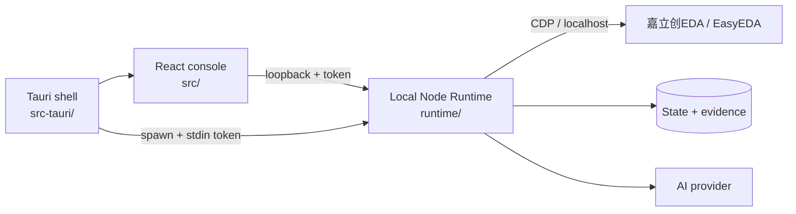

# CircuitPilot — AI PCBA Control

**English** · [简体中文](README.zh-CN.md)

[](https://github.com/206758633-sudo/CircuitPilot-AI-PCB-CONTROL/actions/workflows/ci.yml)
[](LICENSE)

CircuitPilot is a **local-first, human-in-the-loop AI PCBA console for macOS**.
It lets **DeepSeek V4.1 Flash** — a lightweight, low-cost model — take part in
real PCBA work, not just chat: the model understands requirements, proposes a
plan, and drives a locally installed 嘉立创EDA / EasyEDA editor through
CircuitPilot's controlled toolchain. Every hardware write still requires an
explicit plan, human approval, read-back, and vendor ERC/DRC; missing evidence
blocks a release instead of producing a fake pass.

> **DeepSeek V4.1 Flash is enough to start.** The model decides *what* to do;
> CircuitPilot's local Runtime proves *what actually happened* — exact target
> identity, approved plan hashes, controlled edits, read-back, evidence, and
> fail-closed release gates.

> **Status:** experimental. Not production-ready for safety-critical,
> medical, automotive, or mission-critical hardware. It is not a substitute
> for an engineer's review, DFM sign-off, or your fabricator's checks.

## Why DeepSeek V4.1 Flash

Most "AI PCB" demos stop at generating text. The hard part is not prose — it is
making every write provable. CircuitPilot moves tool execution, validation,
rollback, and evidence into the local Runtime, so design capability is not
locked to the most expensive model.

That is why **DeepSeek V4.1 Flash (`deepseek-v4.1-flash`)** can be sufficient
for a real workflow: it handles requirement understanding, planning, and tool
selection, while the Runtime enforces target identity, approvals, read-back,
and ERC/DRC. When the software cannot prove something, it says
**unknown/blocked** — never "passed".

## Features

- Local-only Runtime on `127.0.0.1` with a per-launch token; no cloud backend.
- Project state, trace, issue ledger, and evidence stored locally.
- AI requirement chat with structured design facts and reviewable plans.
- Controlled EDA execution through the vendor editor's debugging interface.
- DRC/ERC evidence capture, pin/net audits, and release-gate reporting.
- **Lightweight-model friendly:** DeepSeek V4.1 Flash (`deepseek-v4.1-flash`)
  and other OpenAI-compatible endpoints work alongside Codex CLI, Claude Code,
  and OpenAI/Anthropic APIs. Keys live in macOS Keychain.
- Bilingual UI (Simplified Chinese / English) with a dense "Clear Bench"
  engineering design system.
- Demo mode for UI walkthroughs; demo data is always labelled.

## Architecture



See [docs/architecture/overview.md](docs/architecture/overview.md) and
[security model](docs/architecture/security-model.md).

**User manual (简体中文):** [操作指导说明书](docs/guides/user-manual.zh-CN.md) · [PDF](docs/guides/CircuitPilot-User-Manual-v0.2.1.zh-CN.pdf)

## Install the macOS app (end users)

Download the latest **Apple Silicon** DMG from
[GitHub Releases](https://github.com/206758633-sudo/CircuitPilot-AI-PCB-CONTROL/releases/latest).

The build is currently **ad-hoc signed, not notarized**. Gatekeeper will warn;
right-click → **Open**, or run:

```bash
xattr -dr com.apple.quarantine /Applications/CircuitPilot.app
```

One-time setup before the first PCB edit:

1. Install and sign in to **嘉立创EDA Professional**.
2. In EDA's extension marketplace, install the official
   **`run-api-gateway` (API Gateway)** extension and enable
   **External Interaction Permission**. CircuitPilot does not redistribute this
   official extension.
3. Open CircuitPilot → **Settings / EDA**, choose your AI provider and add your
   own API key or CLI. The Demo works without a key; real design work needs one.
4. Open the target project in EDA, then in CircuitPilot **EDA 执行** click
   **启动EDA** and **重连**. The local bridge daemon starts automatically with
   the app; you do not need to run `node bridge-server.mjs`.

For **DeepSeek V4.1 Flash**, choose **DeepSeek 开放平台** (or a custom
OpenAI-compatible provider), enter your API key, and set the model to
`deepseek-v4.1-flash` (use the exact ID shown in your DeepSeek console if it
differs). The provider's model list can also be overridden by typing the ID.

**What still requires the user:** a Mac (Apple Silicon), the EDA app/account,
the official EDA extension, an AI provider key/CLI, and the Gatekeeper override
above. Without those, only the labelled Demo is usable. See the
[manual](docs/guides/user-manual.zh-CN.md) for details.

## Quick start

Requirements: macOS 12+, Node.js 22+, npm. For the desktop shell: Rust and
Xcode command line tools.

```bash
git clone https://github.com/206758633-sudo/CircuitPilot-AI-PCB-CONTROL.git
cd CircuitPilot-AI-PCB-CONTROL
npm ci
npm run dev:full
```

- Console: <http://127.0.0.1:4177>
- Runtime health: <http://127.0.0.1:4178/api/health>

Desktop app (development):

```bash
npm run desktop:dev
```

Build a macOS bundle:

```bash
npm run desktop:app
# -> src-tauri/target/release/bundle/macos/CircuitPilot.app
```

## Configuration

Configure AI providers and EDA in the app's **Settings**. API keys are stored
in macOS Keychain. Development-only overrides are documented in
[docs/getting-started/configuration.md](docs/getting-started/configuration.md)
and [.env.example](.env.example). Never commit real keys.

## Safety boundaries

- The Runtime binds to loopback only and rejects requests without the
  per-launch token (`401` is expected for external processes).
- Hardware writes are disabled by default; they require exact target identity,
  a complete plan, human approval, a source snapshot, and read-back.
- After a write, the vendor ERC/DRC runs. Failure restores from the snapshot.
- The release gate is fail-closed: missing/stale/mismatched DRC, ERC, DFM,
  BOM/CPL, or sign-off evidence is reported as blocked.
- **No automatic ordering or payment.** No fabricated results.

## Repository layout

```
src/            React + TypeScript console
src-tauri/      Tauri 2 / Rust macOS shell
runtime/        Local Node Runtime, EDA bridge, evidence, gates
scripts/        Dev / verification / release helpers
e2e/            Playwright end-to-end tests
docs/           Architecture, setup, usage, design, limitations
spec/ rules/ openspec/   Design contracts and rule data
```

## Tests

```bash
npm run typecheck
npx vitest run
npm run test:runtime
npm run test:e2e     # needs Playwright browsers
npm run build
```

## Packaging and releases

Packaged `.app`/`.dmg` files are **not committed to git** (they are large
binaries and should not live in the source tree). Releases are published as
GitHub Release assets; the repository keeps the source, docs, and build
workflow. Builds are unsigned (ad-hoc) unless Developer ID signing and
notarization are configured — see
[docs/getting-started/macos-signing.md](docs/getting-started/macos-signing.md).

## Not included

To respect third-party rights and keep the repository focused on software,
this repository does **not** include: customer/board source files, reference
designs, Gerber/BOM/CPL/STEP outputs, internal evidence bundles, or the
private knowledge dataset. See [docs/pcb/limitations.md](docs/pcb/limitations.md).

## Contributing

See [CONTRIBUTING.md](CONTRIBUTING.md). Security issues: use GitHub Security
Advisories, not public issues.

## License

Apache License 2.0 — see [LICENSE](LICENSE) and [NOTICE](NOTICE). Third-party
components are listed in [THIRD_PARTY_LICENSES.md](THIRD_PARTY_LICENSES.md).
Vendor names and trademarks belong to their owners; this project is not
affiliated with or endorsed by them.
