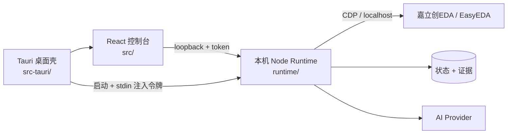

# CircuitPilot — AI PCBA 控制台

[English](README.md) · **简体中文**

[](https://github.com/206758633-sudo/CircuitPilot-AI-PCB-CONTROL/actions/workflows/ci.yml)
[](LICENSE)

CircuitPilot 是面向 macOS 的**本地优先、人在环** AI PCBA 控制台。它把
React 控制台、Tauri/Rust 桌面壳与本机 Node Runtime 连接到你本机已登录的
EDA 编辑器（嘉立创EDA / EasyEDA）。设计上刻意保守：每次硬件写入都需要
明确计划、人工批准、回读与厂商 ERC/DRC；证据不足时发布会保持阻断，
而不是伪造"通过"。

> **状态：实验性项目。** 不适用于安全关键、医疗、汽车或任务关键硬件；
> 不能替代工程师评审、DFM 签核或板厂检查。

## 为什么做这个

多数 "AI PCB" 演示停在生成文本。CircuitPilot 关注更难的部分：精确目标身份、
计划哈希审批、受控写入、回读、证据留存与 fail-closed 放行门禁。软件无法证明
的事情，只会显示 **unknown/blocked**，不会显示 pass。

## 能力

- 仅监听 `127.0.0.1` 的本地 Runtime，每次启动注入一次性令牌；没有云端后端。
- 项目状态、trace、问题台账与证据全部保存在本机。
- AI 需求对话，产出结构化设计事实与可审阅计划。
- 通过 EDA 调试接口执行受控原理图/PCB 操作。
- DRC/ERC 证据采集、引脚/网络审计、放行门禁报告。
- Provider：Codex CLI、Claude Code、OpenAI/Anthropic API，以及自定义
  OpenAI/Anthropic 兼容端点；Key 保存在 macOS 钥匙串。
- 中英双语界面与"Clear Bench"工程化设计系统。
- Demo 模式用于界面走查，模拟数据始终显式标注。

## 架构



详见 [架构说明](docs/architecture/overview.md) 与
[安全模型](docs/architecture/security-model.md)。

**操作指导说明书：** [Markdown](docs/guides/user-manual.zh-CN.md) · [PDF](docs/guides/CircuitPilot-User-Manual-v0.2.1.zh-CN.pdf)

## 下载安装 macOS 应用（普通用户）

从 [GitHub Releases](https://github.com/206758633-sudo/CircuitPilot-AI-PCB-CONTROL/releases/latest)
下载最新的 **Apple Silicon** DMG。

当前构建是 **ad-hoc 签名、未做 Apple 公证**，Gatekeeper 会提示；请右键 →
**打开**，或执行：

```bash
xattr -dr com.apple.quarantine /Applications/CircuitPilot.app
```

第一次真正设计 PCB 前，需要完成一次性的本地准备：

1. 安装并登录 **嘉立创EDA专业版**。
2. 在 EDA 扩展广场安装官方 **`run-api-gateway`（API Gateway）**，并开启
   **外部交互权限**。这个官方扩展不由 CircuitPilot 分发。
3. 打开 CircuitPilot → **设置 / EDA**，选择 AI Provider，填入你自己的
   API Key 或 CLI。没有 Key 时只能用带标记的 Demo；真实设计需要 Provider。
4. 在 EDA 打开目标工程，然后在 CircuitPilot 的 **EDA 执行** 页点
   **“启动EDA”** → **“重连”**。本地桥接进程会随应用自动启动，不需要手动
   运行 `node bridge-server.mjs`。

**仍然需要用户自己准备：** Apple Silicon Mac、EDA 应用/账号、官方 EDA
扩展、AI Provider Key/CLI，以及上面的 Gatekeeper 手动放行。缺这些时只有
明确标注的 Demo 可用，不能控制真实 EDA。详见[操作指导说明书](docs/guides/user-manual.zh-CN.md)。

## 快速开始

要求：macOS 12+、Node.js 22+、npm；桌面壳还需要 Rust 与 Xcode 命令行工具。

```bash
git clone https://github.com/206758633-sudo/CircuitPilot-AI-PCB-CONTROL.git
cd CircuitPilot-AI-PCB-CONTROL
npm ci
npm run dev:full
```

- 控制台：<http://127.0.0.1:4177>
- Runtime 健康检查：<http://127.0.0.1:4178/api/health>

桌面应用（开发）：

```bash
npm run desktop:dev
```

构建 macOS 安装包：

```bash
npm run desktop:app
# -> src-tauri/target/release/bundle/macos/CircuitPilot.app
```

## 配置

在应用内 **系统设置** 配置 AI Provider 与 EDA。API Key 写入 macOS 钥匙串；
开发用环境变量见 [配置文档](docs/getting-started/configuration.md) 与
[.env.example](.env.example)。不要把真实密钥提交进仓库。

## 安全边界

- Runtime 只监听回环地址；没有启动令牌的外部请求返回 `401`（预期行为）。
- 硬件写入默认关闭；需要精确目标身份、完整计划、人工批准、源码快照与回读。
- 写入后执行厂商 ERC/DRC；失败会用快照恢复。
- 放行门禁 fail-closed：DRC/ERC/DFM/BOM/CPL/签核证据缺失、过期或不匹配时，
  一律显示阻断。
- **不自动下单、不自动支付；不伪造结果。**

## 仓库结构

```
src/            React + TypeScript 控制台
src-tauri/      Tauri 2 / Rust macOS 桌面壳
runtime/        本机 Node Runtime、EDA Bridge、证据与门禁
scripts/        开发 / 验证 / 发布脚本
e2e/            Playwright 端到端测试
docs/           架构、安装、使用、设计、限制
spec/ rules/ openspec/   设计契约与规则数据
```

## 测试

```bash
npm run typecheck
npx vitest run
npm run test:runtime
npm run test:e2e     # 需要 Playwright 浏览器
npm run build
```

## 打包与发布

`.app`/`.dmg` **不提交进 git**（大二进制不应进源码树）。发布包通过
GitHub Releases 提供；仓库保留源码、文档和构建工作流。未配置 Developer ID
签名与公证时，构建为 ad-hoc 签名，详见
[macOS 签名手册](docs/getting-started/macos-signing.md)。

## 未包含的内容

为尊重第三方权利并保持仓库聚焦软件，本仓库**不包含**：客户/测试板源文件、
参考设计、Gerber/BOM/CPL/STEP 等制造产物、内部证据包以及私有知识数据集。
详见 [能力与限制](docs/pcb/limitations.md)。

## 贡献

见 [CONTRIBUTING.md](CONTRIBUTING.md)。安全问题请使用 GitHub Security
Advisories，不要开公开 issue。

## 许可证

Apache License 2.0 —— 见 [LICENSE](LICENSE) 与 [NOTICE](NOTICE)。第三方组件见
[THIRD_PARTY_LICENSES.md](THIRD_PARTY_LICENSES.md)。文中出现的厂商名称与商标
归各自所有者，本项目与其无隶属或背书关系。
