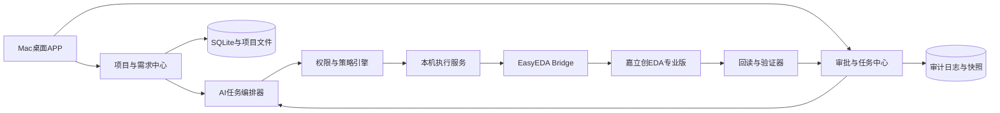
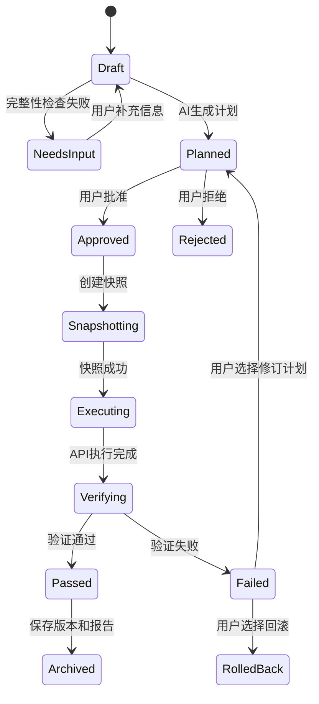

# AI 电路板设计控制台（Mac）产品需求文档

> 产品暂定名：AI 电路板设计控制台  
> 文档版本：v0.1 Draft  
> 文档日期：2026-08-11  
> 目标平台：macOS  
> 首要目标用户：个人硬件工程师  
> 产品负责人：待确认  
> 文档状态：待产品评审

## 0. 文档说明

### 0.1 编写目的

本文档定义一款优先运行于 macOS 的 AI 电路板设计控制软件。产品通过结构化需求、人工审批、受控执行、回读验证和版本追溯，帮助用户使用 AI 安全地操作嘉立创EDA专业版，完成从需求分析到原理图、PCB和生产资料准备的工程流程。

本文档用于：

- 统一产品目标、范围和边界；
- 指导交互设计、技术架构和开发实施；
- 作为后续 OpenSpec proposal、spec、design、tasks 的产品输入；
- 作为功能测试、验收和版本评审的依据。

### 0.2 需求状态定义

| 状态 | 含义 |
|---|---|
| 已确认 | 已在当前讨论中明确，可以进入设计 |
| 产品建议 | PRD给出的推荐方案，需产品负责人评审 |
| 待决策 | 会影响产品范围或架构，进入开发前必须确认 |
| 后续版本 | 不进入MVP，保留扩展能力 |

### 0.3 修订记录

| 版本 | 日期 | 修改内容 | 修改人 |
|---|---|---|---|
| v0.1 Draft | 2026-08-11 | 建立Mac桌面端完整PRD初稿 | Codex |

## 1. 产品概述

### 1.1 背景

现有通用AI聊天工具能够解释电路、生成建议或代码，但难以稳定承担真实PCBA工程操作，主要问题包括：

- 需求散落在多轮对话中，缺少统一且可验证的工程事实；
- AI可能在参数不完整时作出未经确认的假设；
- 用户难以在执行前准确理解AI将修改哪些设计对象；
- 操作成功不代表电气设计、制造规则或机械约束正确；
- 缺少审批、操作日志、版本快照、失败恢复和回滚机制；
- 提示词本身无法代替ERC、DRC、网表、封装、DFM等工程检查；
- 云端服务直接连接本机EDA会产生权限、隐私和安全风险。

### 1.2 产品定位

AI电路板设计控制台是一款本地优先的macOS桌面软件。它不是嘉立创EDA的替代品，也不是单纯的AI聊天窗口，而是连接用户、AI设计代理和嘉立创EDA专业版的工程控制与审批中枢。

产品承担以下职责：

1. 将产品需求、电气参数、元件资料和机械约束结构化；
2. 识别缺失、冲突和未经确认的信息；
3. 让AI生成可审阅的设计方案和操作计划；
4. 只将用户批准的操作发送到本机嘉立创EDA；
5. 执行后重新读取实际状态并进行工程验证；
6. 保存版本、证据、差异、验证结果和完整审计记录。

### 1.3 核心价值

- **准确**：关键参数必须有来源和确认状态，未知项禁止猜测。
- **可控**：AI只在本次批准的工程、对象和动作范围内执行。
- **可验证**：每次修改都执行回读和工程检查，不能只依赖API成功状态。
- **可恢复**：修改前创建快照，失败后可比较、重试或回滚。
- **可追溯**：保留需求来源、AI方案、审批、API调用和验证结果。
- **可扩展**：AI供应商、EDA连接器和验证器采用适配器设计。

## 2. 已确认事项、产品建议与待决策项

### 2.1 已确认事项

| 编号 | 事项 | 当前结论 |
|---|---|---|
| D-001 | 首发平台 | 优先开发Mac桌面控制软件 |
| D-002 | 目标EDA | 嘉立创EDA专业版 |
| D-003 | 首要用户 | 个人用户、硬件工程师 |
| D-004 | EDA连接方式 | 本机EasyEDA API Skill、Bridge和官方API Gateway |
| D-005 | 设计输入 | 元件清单、功能、PCB尺寸图及完整工程约束 |
| D-006 | 核心原则 | 信息不足先提问，关键参数不允许猜测 |
| D-007 | 执行原则 | 修改前计划与审批，修改后回读与验证 |

### 2.2 产品建议

| 编号 | 建议 | 理由 |
|---|---|---|
| R-001 | MVP采用本地优先、单机架构 | 最小化数据泄露和远程控制风险 |
| R-002 | 初期通过签名、公证DMG分发，不进入Mac App Store | App Sandbox可能限制进程、文件和本地EDA控制能力 |
| R-003 | 使用Tauri 2、React、TypeScript、Rust、SQLite | 兼顾桌面能力、体积、安全和未来扩展 |
| R-004 | 复用现有Node Bridge作为受控Sidecar | 降低MVP重写风险 |
| R-005 | MVP先实现只读检查和小范围受控修改闭环 | 先证明可靠性，再扩大自动化范围 |
| R-006 | AI接口采用Provider Adapter | 避免产品与单一模型或单一调用方式强耦合 |

### 2.3 待决策项

| 编号 | 待决策事项 | 推荐默认值 | 截止阶段 |
|---|---|---|---|
| O-001 | 仅个人自用还是规划商业化 | MVP按个人单机设计，保留商业化能力 | PRD评审 |
| O-002 | 用户自带AI API账户还是产品统一提供 | MVP使用用户自带账户 | 架构设计前 |
| O-003 | 项目资料是否完全本地保存 | MVP完全本地保存 | 架构设计前 |
| O-004 | 审批粒度 | 默认逐批任务审批，高风险动作单独审批 | 交互设计前 |
| O-005 | MVP是否必须支持整板从零自动完成 | MVP支持从零建项和方案，不承诺无人监督完成整板 | 范围冻结前 |
| O-006 | 支持的最低macOS版本 | 待技术验证 | 开发前 |
| O-007 | Apple Silicon之外是否支持Intel Mac | MVP建议仅Apple Silicon | 开发前 |
| O-008 | 是否需要登录和云同步 | MVP不需要 | 商业化评审 |

## 3. 产品目标与非目标

### 3.1 MVP目标

1. 用户可以在Mac上创建和管理AI电路板设计项目。
2. 用户可以结构化录入功能、电源、接口、BOM、机械和制造约束。
3. 系统可以识别必填信息缺失、参数冲突和证据缺失。
4. 系统可以稳定检测嘉立创EDA、Bridge和活动窗口状态。
5. AI可以对当前工程执行只读检查并生成结构化报告。
6. AI可以生成明确的变更计划、影响范围和验证方案。
7. 用户可以按任务批准或拒绝AI操作。
8. 系统可以执行一组小范围、可回滚的嘉立创EDA修改。
9. 系统可以在执行后回读实际结果并显示差异。
10. 系统可以保存版本、操作日志和验证结果。

### 3.2 MVP非目标

- 不承诺无人监督完成任意复杂度的整块PCBA；
- 不提供云端直接控制用户本机EDA；
- 不自动提交PCB或PCBA订单；
- 不替代持证安规、EMC、医疗、汽车或射频工程师签核；
- 不在MVP提供多人实时协作；
- 不在MVP提供手机远程控制；
- 不在MVP实现完整的自动布线器或电磁场仿真器；
- 不允许AI绕过用户审批直接删除、覆盖、导出或下单。

### 3.3 成功指标

| 编号 | 指标 | MVP目标 |
|---|---|---|
| KPI-001 | 支持环境下EDA连接成功率 | 连续100次启动测试不低于99% |
| KPI-002 | 未经审批的设计写操作 | 0次 |
| KPI-003 | 已执行任务操作日志覆盖率 | 100% |
| KPI-004 | 修改前快照覆盖率 | 100%写任务 |
| KPI-005 | 执行后回读验证覆盖率 | 100%写任务 |
| KPI-006 | 高风险动作二次确认覆盖率 | 100% |
| KPI-007 | 小范围标准任务执行成功率 | 不低于95% |
| KPI-008 | 失败任务可诊断率 | 100%返回明确阶段和错误原因 |
| KPI-009 | 快照回滚成功率 | 标准测试场景100% |
| KPI-010 | 关键需求字段来源可追溯率 | 100% |

## 4. 用户与使用场景

### 4.1 主要用户画像

#### U-001 个人硬件工程师

- 熟悉基础原理图和PCB设计；
- 使用Mac和嘉立创EDA专业版；
- 希望减少资料整理、重复操作和检查工作；
- 需要理解并控制AI做出的每项重要修改；
- 可能没有完整的软件开发背景。

#### U-002 产品或结构负责人（后续版本）

- 提供功能、外壳、尺寸和接口要求；
- 主要查看需求完整性、进度和结构干涉结果；
- 不直接执行EDA修改。

#### U-003 电路板审核工程师（后续版本）

- 评审原理图、PCB、BOM和验证结果；
- 对高风险设计或量产资料作最终签核。

### 4.2 核心使用场景

| 场景 | 用户目标 | MVP支持 |
|---|---|---|
| S-001 | 从零建立一个PCBA设计项目 | 支持建项、需求收集和方案生成 |
| S-002 | 检查已有嘉立创EDA工程 | 完整支持 |
| S-003 | 对已有工程执行小范围修改 | 完整支持受控闭环 |
| S-004 | 生成完整原理图 | 分阶段支持，需逐步审批 |
| S-005 | 完成PCB布局和关键网络布线 | 后续版本 |
| S-006 | 自动修复DRC问题 | 后续版本，逐项审批 |
| S-007 | 生成制造资料 | 后续版本，高风险确认 |
| S-008 | 提交嘉立创订单 | 不支持自动提交 |

## 5. 产品原则

1. **本地优先**：EDA连接、工程文件、执行日志和快照默认保存在本机。
2. **事实优先**：用户确认和正式资料优先于AI经验。
3. **未知即阻断**：关键字段未知时必须提问，不能填充猜测值。
4. **计划先于执行**：任何写操作必须属于可审阅的批准计划。
5. **最小权限**：任务只获得完成当前步骤所需的最小能力。
6. **验证闭环**：执行成功后必须回读，必要时运行ERC、DRC或其他检查。
7. **可恢复**：写操作前必须建立可恢复点。
8. **高风险人工决策**：删除、覆盖、导出、授权和下单不能静默执行。
9. **证据可追溯**：关键设计决策必须关联数据来源。
10. **AI可替换、工程规则不可丢失**：项目事实和规则不能只存在于模型上下文中。

## 6. 产品总体架构



### 6.1 桌面应用

- 提供所有可视化界面；
- 管理项目和授权目录；
- 展示EDA、Bridge和AI连接状态；
- 承载任务计划、审批、执行进度和验证结果；
- 不直接保存明文API密钥。

### 6.2 AI任务编排器

- 组装结构化项目上下文；
- 调用AI Provider；
- 强制要求AI返回符合Schema的计划；
- 将自然语言意图转换为受控任务；
- 不能直接绕过策略引擎调用EDA。

### 6.3 权限与策略引擎

- 校验任务状态和批准记录；
- 校验工程、文件目录、对象类型和动作白名单；
- 拦截计划外操作；
- 对高风险动作触发操作时确认；
- 生成不可变更的执行任务包。

### 6.4 本机执行服务

- 管理Bridge生命周期；
- 通过127.0.0.1与Gateway通信；
- 串行或按安全规则调度EDA操作；
- 记录请求、响应、时间、窗口和工程；
- 支持超时、取消、重试和断线恢复。

### 6.5 回读与验证器

- 调用只读API获取执行后的真实状态；
- 对比计划前后的对象、属性和数量；
- 运行可用的ERC、DRC、网表、BOM和几何检查；
- 产生通过、警告、失败及豁免报告。

## 7. 信息架构与页面

### 7.1 主导航

1. 项目
2. 需求
3. BOM与资料
4. AI任务
5. EDA控制台
6. 验证
7. 版本与日志
8. 设置

### 7.2 全局状态栏

应用所有核心页面都应显示：

- 嘉立创EDA：未运行、运行未连接、已连接、连接异常；
- 当前工程：无、工程名称、工程版本；
- AI：未配置、可用、调用中、异常；
- 当前权限：只读、受控写入、高风险待确认；
- 当前任务：空闲、等待补充、待审批、执行中、验证中、失败；
- 未保存或未验证提醒。

## 8. 核心业务流程

### 8.1 新建项目流程

1. 用户创建项目并选择本地目录。
2. 系统检查目录读写权限和现有文件。
3. 用户选择“从零设计”或“接入已有工程”。
4. 用户填写需求表并上传BOM、数据手册、板框和结构资料。
5. 系统检查完整性、格式、冲突和关键缺失项。
6. AI生成缺失问题、风险清单、系统框图和阶段建议。
7. 用户确认需求基线。
8. 系统允许生成首个设计任务计划。

### 8.2 受控修改流程



### 8.3 高风险操作流程

以下操作即使已在一般任务中批准，仍需在操作发生前单独确认：

- 永久删除设计对象或文件；
- 覆盖已有工程或制造文件；
- 打开可能丢失未保存数据的工程；
- 修改板框、层叠、阻抗或安全间距；
- 批量替换元件或封装；
- 导出Gerber、BOM、坐标等生产资料；
- 启用新的持久访问权限；
- 上传工程数据到第三方；
- 提交PCB/PCBA订单。

## 9. 功能需求

### 9.1 FR-001 首次启动与环境检查

**优先级**：P0  
**用户故事**：作为硬件工程师，我希望应用自动检查本机环境，以便在设计前确认所有依赖可用。

**功能要求**：

- 检测macOS版本和CPU架构；
- 检测嘉立创EDA专业版是否安装及版本；
- 检测嘉立创EDA是否已激活；
- 检测Run API Gateway是否安装、启用并允许外部交互；
- 检测EasyEDA API Skill和Bridge运行状态；
- 检测活动EDA窗口数量；
- 多窗口时要求用户选择目标窗口；
- 提供可复制的诊断报告；
- 环境不完整时提供分步修复指引，不静默修改安全设置。

**验收标准**：

- [ ] 支持环境下，30秒内完成全部检查；
- [ ] 能区分EDA未安装、未运行、未授权、Gateway未启用、Bridge未启动和多窗口状态；
- [ ] 未获得确认时不自动开启外部交互权限；
- [ ] 连接成功后显示活动窗口ID和只读测试结果。

### 9.2 FR-010 项目管理

**优先级**：P0  
**用户故事**：作为用户，我希望每个PCBA设计拥有独立的项目空间，以便隔离资料、权限和版本。

**功能要求**：

- 创建、打开、归档项目；
- 项目字段包含名称、内部代号、产品说明、负责人、阶段和目标日期；
- 选择并授权唯一项目根目录；
- 记录关联嘉立创EDA工程路径；
- 支持“从零设计”和“已有工程”两种模式；
- 展示资料完整度、设计阶段、未解决风险和最近验证状态；
- 项目归档不删除原始文件；
- 切换项目前检查进行中的任务和未保存状态。

**验收标准**：

- [ ] 项目之间的数据和授权目录互相隔离；
- [ ] AI无法读取未授权目录；
- [ ] 归档项目可恢复；
- [ ] 切换项目不会把任务发送到错误的EDA工程。

### 9.3 FR-020 需求与约束中心

**优先级**：P0  
**用户故事**：作为硬件工程师，我希望把所有要求结构化保存，以便AI基于稳定事实工作。

**功能要求**：

- 支持功能、电源、接口、主控、模拟、驱动、无线、高速、机械、热、环境、制造、测试和合规分类；
- 每个字段保存数值、单位、范围、来源、状态、责任人和更新时间；
- 状态包括未知、AI建议、待确认、已确认、冲突、废弃；
- 支持硬约束和软约束；
- 支持条件必填逻辑，例如选择锂电池后显示充电与保护问题；
- 支持需求基线和变更记录；
- 关键字段冲突时阻止写任务进入审批；
- AI只能将建议写入“AI建议”，不能自行标记“已确认”。

**验收标准**：

- [ ] 所有关键电气和机械参数都有确认状态；
- [ ] 未知关键字段会产生明确问题清单；
- [ ] 已确认硬约束被修改时触发影响分析和重新审批；
- [ ] 可以导出完整需求基线Markdown和JSON。

### 9.4 FR-030 文件、资料与证据管理

**优先级**：P0

**功能要求**：

- 支持PDF、Markdown、CSV、XLSX、DXF、STEP、图片和嘉立创EDA工程文件；
- 记录文件名称、路径、哈希、版本、来源和关联对象；
- 数据手册支持关联制造商型号和关键参数；
- 机械图支持记录单位、原点、版本和公差；
- 文件变化后标记相关结论可能过期；
- 支持用户将某份资料指定为正式依据；
- 不自动将本地文件上传到云端。

**验收标准**：

- [ ] 相同文件可以通过哈希识别；
- [ ] 文件被外部修改后能提示重新解析；
- [ ] AI输出的关键参数可以追溯到来源文件；
- [ ] 未经授权的文件路径不可访问。

### 9.5 FR-040 BOM与元件管理

**优先级**：P0

**功能要求**：

- 导入CSV/XLSX BOM；
- 管理位号、数量、制造商型号、品牌、封装、参数、LCSC编号和采购属性；
- 区分必选、可替代、禁用和待选型元件；
- 记录替代料边界和批准状态；
- 校验符号、封装、3D模型和数据手册引脚一致性；
- 标记缺少数据手册、封装或采购编号的条目；
- 支持AI提出选型比较，但必须由用户批准选型；
- 记录元件生命周期、库存和价格证据的查询时间。

**验收标准**：

- [ ] BOM导入错误可以定位到行和字段；
- [ ] 必选元件不能被AI静默替换；
- [ ] 替代料变更触发引脚、封装、参数和成本复核；
- [ ] BOM可以导出当前版和变更对比版。

### 9.6 FR-050 嘉立创EDA连接与只读检查

**优先级**：P0  
**用户故事**：作为用户，我希望先确认AI读取的是正确窗口和工程，再授予修改权限。

**功能要求**：

- 显示Bridge健康状态、端口、EDA连接数和活动窗口；
- 只允许连接本机回环地址；
- 获取当前页面类型、工程信息和文档信息；
- 多窗口时禁止自动猜测目标窗口；
- 支持手动重连、切换活动窗口和停止连接；
- 写操作前再次校验窗口、工程和文档；
- 连接断开时自动暂停任务，不自动切换到其他窗口。

**验收标准**：

- [ ] 只读查询不会修改工程；
- [ ] 多窗口时必须明确选择；
- [ ] 执行前后记录窗口ID和工程标识；
- [ ] 断线后任务进入暂停或失败状态，不出现部分操作继续执行。

### 9.7 FR-060 AI对话与任务编排

**优先级**：P0

**功能要求**：

- 支持自然语言任务输入；
- 将项目事实、约束、资料索引和权限组合成结构化上下文；
- AI首先返回缺失信息、冲突、假设和风险；
- 信息充分后生成结构化任务计划；
- 计划包含目标、依据、前置条件、步骤、涉及对象、预期变化、风险、验证方法和回滚策略；
- 任务必须符合JSON Schema；
- 禁止AI直接把自然语言输出作为可执行代码；
- 支持取消生成、重新生成和比较两个方案；
- 记录模型、提示版本和输入证据版本。

**验收标准**：

- [ ] 关键输入缺失时计划状态为“等待补充”；
- [ ] 每个写步骤都有预期结果和验证项；
- [ ] 计划外API调用被策略引擎拒绝；
- [ ] 用户可以看懂AI准备修改什么以及为什么。

### 9.8 FR-070 审批与权限管理

**优先级**：P0

**功能要求**：

- 权限按项目、任务、动作和有效期授予；
- 权限级别包括只读、创建、修改、移动、布线、保存、导出和高风险动作；
- 用户可以批准全部步骤或选择部分步骤；
- 修改计划后原批准自动失效；
- 高风险动作必须在发生时再次确认；
- 批准记录包含用户、时间、计划哈希和权限范围；
- 支持立即撤销本次任务的未使用权限；
- 总开关“暂停所有AI写操作”。

**验收标准**：

- [ ] 未批准任务无法进入执行队列；
- [ ] 修改后的计划不能复用旧批准；
- [ ] 暂停开关在当前API步骤结束后阻止后续步骤；
- [ ] 批准记录可在审计页面查询。

### 9.9 FR-080 EDA执行引擎

**优先级**：P0

**功能要求**：

- 仅执行由任务计划编译生成的类型化命令；
- 每次API调用前读取官方方法签名和参数约束；
- 执行前校验前置条件；
- 命令包含唯一ID，防止断线重试产生重复副作用；
- 默认串行执行写操作；
- 支持超时、取消和有限重试；
- 任何一步失败后停止后续依赖步骤；
- 保存实际请求、结果、错误和耗时；
- 不执行下单、支付或不可逆外部操作。

**验收标准**：

- [ ] 相同命令ID不会被重复执行；
- [ ] API返回错误时可以定位到计划步骤；
- [ ] 执行中断后能区分未执行、执行中和已完成步骤；
- [ ] 写操作全部关联快照和批准记录。

### 9.10 FR-090 回读、差异与工程验证

**优先级**：P0

**功能要求**：

- 执行后重新读取被修改对象；
- 对比预期与实际属性、数量、网络和位置；
- 将差异分为预期、非预期、无法验证；
- 支持ERC、DRC、网表、BOM、板框、安装孔、封装和连接检查；
- 验证项具有通过、警告、失败、豁免状态；
- 豁免必须填写原因、批准人和适用版本；
- 失败时提供修订计划或回滚选项；
- 未通过验证的版本不得标记为“可交付”。

**验收标准**：

- [ ] 每个写步骤至少有一个回读断言；
- [ ] 非预期差异会停止任务并突出显示；
- [ ] 验证报告关联工程版本和设计规则版本；
- [ ] 豁免项可以独立导出。

### 9.11 FR-100 版本、快照与回滚

**优先级**：P0

**功能要求**：

- 写任务前自动创建版本快照；
- 快照包含工程文件、需求基线、BOM版本、计划和校验摘要；
- 支持用户手动创建里程碑版本；
- 显示两个版本间的结构化差异；
- 回滚前检查当前未保存修改；
- 回滚属于高风险动作，需要确认；
- 回滚后重新连接EDA并执行只读验证；
- 不通过简单覆盖破坏唯一原始副本。

**验收标准**：

- [ ] 标准测试项目可以恢复到修改前状态；
- [ ] 回滚操作本身产生审计记录；
- [ ] 无可用快照时不显示可执行的回滚按钮；
- [ ] 快照空间不足时在写任务前阻断。

### 9.12 FR-110 交付物生成

**优先级**：P1

**功能要求**：

- 支持选择原始工程、原理图PDF、BOM、坐标、Gerber、钻孔、装配图、3D模型和验证报告；
- 生成前显示当前验证状态和未关闭风险；
- 制造文件生成需要操作时确认；
- 输出到项目内独立版本目录；
- 生成文件清单、哈希和版本说明；
- 不自动上传或提交订单；
- 未通过强制验收门槛时默认禁止标记“量产版”。

**验收标准**：

- [ ] 输出不会覆盖旧版本目录；
- [ ] 每个交付包包含清单和版本信息；
- [ ] 存在失败项时需要明确风险接受才能生成“工程评审包”；
- [ ] 系统中不存在自动点击“下单”或“支付”的路径。

### 9.13 FR-120 设置、AI账户与密钥

**优先级**：P0

**功能要求**：

- 配置AI Provider、模型和调用方式；
- 密钥保存到macOS Keychain；
- 界面不回显完整密钥；
- 支持连接测试和权限撤销；
- 支持设置单任务预算和调用上限；
- 支持导入、导出非敏感配置；
- 日志自动脱敏；
- 更换AI Provider不影响项目事实和历史记录。

**验收标准**：

- [ ] 数据库和普通日志中不存在明文密钥；
- [ ] 删除账户配置后无法继续调用对应Provider；
- [ ] 调用失败不会把密钥写入错误报告；
- [ ] 模型输出和工具执行可以分别禁用。

### 9.14 FR-130 日志、诊断与审计

**优先级**：P0

**功能要求**：

- 记录项目事件、需求变更、AI调用、批准、执行、验证和回滚；
- 日志带时间、任务ID、步骤ID、版本和结果；
- 敏感信息和文件内容默认不进入普通日志；
- 提供按任务、类型、状态和时间筛选；
- 支持导出诊断包；
- 诊断包生成前显示包含内容；
- 用户不能在界面中静默删除审计记录；
- 日志保留和清理策略可配置。

**验收标准**：

- [ ] 任一设计变更可追溯到任务和批准记录；
- [ ] 诊断包不包含API密钥；
- [ ] 日志写入失败会阻断写任务或明确降级状态；
- [ ] 时间顺序和任务关联正确。

## 10. AI设计约束规范

### 10.1 信息优先级

AI必须按照以下顺序使用信息：

1. 用户已确认且未过期的项目约束；
2. 指定型号的正式数据手册；
3. 芯片厂官方参考设计和应用笔记；
4. 用户指定的制造和装配规则；
5. 嘉立创EDA及板厂规则；
6. 经用户批准的团队规范；
7. AI工程建议。

低优先级信息不能覆盖高优先级信息。发现冲突时必须停止相关步骤并展示冲突。

### 10.2 AI任务输出结构

每个任务计划至少包含：

```json
{
  "task_id": "uuid",
  "project_id": "uuid",
  "mode": "read_only | controlled_write",
  "goal": "任务目标",
  "evidence": [],
  "unknowns": [],
  "conflicts": [],
  "assumptions": [],
  "allowed_scope": {},
  "forbidden_scope": {},
  "steps": [],
  "risks": [],
  "verification": [],
  "rollback": {},
  "approval_required": true
}
```

### 10.3 强制规则

- 关键参数未知时不得执行相关写操作；
- 未经用户确认的AI建议不能成为已确认事实；
- 禁止凭相似型号推断引脚或封装；
- 禁止跳过数据手册和API方法签名核对；
- 禁止把自然语言直接作为任意代码执行；
- 禁止在未验证窗口和工程时执行写操作；
- 禁止在断线后向自动发现的另一窗口继续任务；
- 禁止将“API成功”表述为“设计验证通过”；
- 禁止静默处理ERC、DRC或制造规则豁免；
- 禁止自动下单。

## 11. 权限矩阵

| 动作 | 默认权限 | 是否需任务审批 | 是否需操作时确认 |
|---|---|---|---|
| 检查连接和窗口 | 允许 | 否 | 否 |
| 读取工程和文档信息 | 允许 | 否 | 否 |
| 读取元件、网络和规则 | 允许 | 否 | 否 |
| 新建工程或文档 | 禁止 | 是 | 视影响决定 |
| 新增元件或网络 | 禁止 | 是 | 否 |
| 修改元件属性 | 禁止 | 是 | 否 |
| 移动元件或修改布线 | 禁止 | 是 | 否 |
| 修改板框、层叠、阻抗、安全间距 | 禁止 | 是 | 是 |
| 批量替换元件或封装 | 禁止 | 是 | 是 |
| 保存工程 | 禁止 | 是 | 可由批准计划包含 |
| 删除对象 | 禁止 | 是 | 是 |
| 覆盖文件 | 禁止 | 是 | 是 |
| 回滚版本 | 禁止 | 是 | 是 |
| 导出生产文件 | 禁止 | 是 | 是 |
| 上传第三方服务 | 禁止 | 是 | 是 |
| 下单或支付 | 永久禁止自动执行 | 不适用 | 必须由用户亲自完成 |

## 12. 数据模型

### 12.1 核心实体

| 实体 | 说明 | 关键字段 |
|---|---|---|
| Project | PCBA项目 | id、name、mode、rootPath、edaProjectPath、stage |
| Requirement | 需求和约束 | category、key、value、unit、status、hardConstraint |
| Evidence | 参数证据 | fileId、sourceType、revision、location、hash |
| FileAsset | 本地资料 | path、type、hash、version、authorized |
| Component | BOM元件 | refdes、mpn、manufacturer、package、lcscId、status |
| AlternatePart | 替代料 | componentId、mpn、constraints、approvalStatus |
| EdaSession | EDA会话 | bridgePort、windowId、projectId、connectedAt |
| AiConversation | AI上下文 | provider、model、promptVersion、projectBaseline |
| TaskPlan | AI任务计划 | goal、scope、steps、risk、planHash、status |
| Approval | 用户批准 | planHash、scope、approvedAt、expiresAt |
| ExecutionStep | 执行步骤 | commandType、precondition、result、duration、status |
| ValidationRun | 验证结果 | type、ruleVersion、status、findings |
| Snapshot | 工程快照 | projectVersion、path、hash、createdAt |
| Deliverable | 交付文件 | type、path、hash、version、validationStatus |
| AuditEvent | 审计事件 | eventType、actor、taskId、timestamp、payloadDigest |

### 12.2 数据状态规则

- Requirement的`confirmed`状态只能由用户操作产生；
- TaskPlan发生任何内容变化后必须生成新的`planHash`；
- Approval只对完全匹配的`planHash`和权限范围有效；
- ExecutionStep不可脱离TaskPlan存在；
- ValidationRun必须关联工程版本；
- Deliverable必须关联Snapshot和验证状态；
- AuditEvent采用追加写入，修正记录通过新事件表达。

## 13. 本机接口与服务契约

### 13.1 应用内部健康检查

应用应提供统一健康状态，至少包含：

```json
{
  "status": "ok | degraded | blocked",
  "database": "connected | error",
  "ai": "ready | unconfigured | error",
  "bridge": "running | stopped | error",
  "eda": "connected | disconnected | multiple_windows",
  "active_project": "uuid | null",
  "write_permission": "disabled | scoped"
}
```

### 13.2 EDA命令封装

应用不得向执行器提交无结构的任意脚本。MVP命令应采用白名单类型，例如：

- `eda.connection.health`
- `eda.window.list`
- `eda.window.select`
- `eda.project.readCurrent`
- `eda.document.readCurrent`
- `eda.object.read`
- `eda.object.create`
- `eda.object.update`
- `eda.object.move`
- `eda.validation.run`
- `eda.project.save`

每种命令均应定义参数Schema、前置条件、权限级别、预期结果和回读方法。

## 14. 非功能需求

### 14.1 性能

- 冷启动目标不超过5秒，不含外部EDA启动时间；
- 普通页面切换目标不超过300毫秒；
- 本地项目搜索目标不超过1秒；
- EDA连接状态变化应在3秒内反映到界面；
- 执行日志应近实时显示，目标延迟不超过1秒；
- 大文件解析应后台运行，不阻塞主界面。

### 14.2 可靠性

- 应用崩溃后保留任务和日志；
- 任务恢复时不得自动重放未确认副作用；
- 数据库写入采用事务；
- 快照失败时禁止继续写EDA；
- Bridge断线时停止依赖步骤；
- 应用退出时明确提示执行中任务。

### 14.3 安全

- Bridge只绑定127.0.0.1；
- API密钥存储在macOS Keychain；
- 项目采用目录级授权；
- 执行器采用命令白名单；
- 所有写任务验证批准哈希；
- 日志默认脱敏；
- 不从工程资料中的文本自动获得权限；
- 插件、数据手册或网页内容均视为不可信输入，不能改变系统规则。

### 14.4 隐私

- MVP默认不要求账号登录；
- 项目资料默认只保存在本机；
- 调用云端AI前展示可能发送的数据类别；
- 支持按任务排除敏感文件；
- 遥测默认关闭或仅收集匿名运行指标；
- 用户可以导出和清理本地项目数据，但审计清理需明确确认。

### 14.5 兼容性

- 首要支持Apple Silicon Mac；
- 嘉立创EDA专业版首个验证基线为V3.2.175；
- Gateway首个验证基线为Run API Gateway v1.0.5；
- 对版本不匹配显示“未验证”而不是假定兼容；
- 应用升级不能破坏既有项目数据。

### 14.6 可用性和无障碍

- 所有关键状态不能只依赖颜色；
- 高风险按钮需要清晰动词和影响对象；
- 错误提示包含原因、影响和下一步；
- 重要表格支持键盘操作和搜索；
- MVP界面语言为简体中文，数据模型保留国际化能力。

## 15. 异常处理与恢复

| 异常 | 系统行为 | 用户可执行动作 |
|---|---|---|
| 嘉立创EDA未运行 | 阻止EDA任务 | 启动EDA并重新检查 |
| Gateway未安装 | 保持只读项目管理 | 查看安装指引 |
| 外部交互未授权 | 不尝试绕过 | 用户进入EDA明确授权 |
| Bridge端口冲突 | 扫描允许端口并报告 | 重启Bridge或查看占用进程 |
| 多个EDA窗口 | 禁止写入 | 选择目标窗口 |
| 执行中断线 | 暂停并标记未知步骤 | 回读确认后恢复或回滚 |
| API超时 | 不自动重复副作用 | 查询实际状态后决定 |
| 数据手册冲突 | 阻断相关设计步骤 | 选择正式依据 |
| 快照失败 | 阻断写操作 | 释放空间或更换目录 |
| ERC/DRC失败 | 标记版本不可交付 | 修订、豁免或回滚 |
| AI输出不符合Schema | 不进入审批 | 自动修复格式或重新生成 |
| API配额或网络失败 | 保留任务上下文 | 重试、切换Provider或离线处理 |

## 16. 测试与验收策略

### 16.1 测试层级

- 单元测试：Schema、状态机、权限判断、路径授权、哈希和差异算法；
- 集成测试：SQLite、Keychain、AI Provider、Bridge和EDA适配器；
- 端到端测试：从建项到审批、执行、验证和回滚；
- 故障注入：断网、断Bridge、关闭EDA、API超时、磁盘空间不足；
- 安全测试：越权目录、计划哈希篡改、日志泄密、恶意资料指令；
- 兼容性测试：不同macOS和嘉立创EDA版本。

### 16.2 MVP强制验收场景

1. 新建项目并授权目录成功。
2. 缺少输入电压时，AI不得生成相关写任务。
3. 连接一个嘉立创EDA窗口并完成只读查询。
4. 多窗口时要求用户选择，不自动猜测。
5. AI生成包含影响范围和验证方法的计划。
6. 未批准时执行请求被拒绝。
7. 批准后完成一个测试元件的受控新增或属性修改。
8. 执行后回读结果与计划一致。
9. 非预期差异导致任务失败并停止。
10. 修改前快照可以恢复。
11. 断线重连不会重复执行已完成步骤。
12. API密钥不出现在数据库、普通日志和诊断包中。
13. 导出操作触发操作时确认。
14. 应用不存在自动下单和自动支付路径。

## 17. 版本规划

### 17.1 M0：基础连接域

**目标**：桌面应用、数据库、Bridge和EDA完成最小通连。

- Mac应用基础框架；
- SQLite初始化；
- 本机健康检查；
- 嘉立创EDA连接状态；
- 只读获取当前窗口、页面和工程；
- 基础日志。

**演示标准**：启动APP后可以明确显示嘉立创EDA连接状态，并完成只读查询。

### 17.2 M1：项目与需求域

**目标**：完整建立一个结构化PCBA项目。

- 项目管理；
- 目录授权；
- 需求和约束中心；
- 文件和证据管理；
- BOM导入；
- 缺失信息与冲突检查。

**演示标准**：导入一组需求、BOM和机械资料，生成可追溯的缺失问题清单。

### 17.3 M2：AI计划与审批域

**目标**：AI可以生成可审阅、不可越权的EDA任务计划。

- AI Provider配置；
- Keychain密钥管理；
- 结构化上下文；
- 任务Schema；
- 权限和审批状态机；
- 高风险动作确认。

**演示标准**：AI生成计划，未批准不能执行，修改计划后旧批准失效。

### 17.4 M3：受控执行与验证域

**目标**：完成一次真实的小范围EDA修改闭环。

- 快照；
- 类型化命令；
- 执行队列；
- 回读差异；
- 基础ERC/DRC或对象级验证；
- 失败停止和回滚；
- 审计报告。

**演示标准**：从批准到修改、回读、验证和回滚均可完整演示。

### 17.5 M4：可发布与文档域

**目标**：形成可安装、可诊断、可维护的MVP。

- 应用签名与公证；
- DMG安装包；
- 升级和数据迁移策略；
- 兼容性与故障测试；
- 用户手册；
- 部署与诊断手册；
- 已知限制说明。

## 18. 风险与应对

| 风险 | 影响 | 应对策略 |
|---|---|---|
| 嘉立创EDA API版本变化 | 命令失效或行为变化 | 版本适配层、签名读取、兼容性矩阵 |
| AI产生错误电气结论 | 设计风险 | 证据优先、未知阻断、人工批准、独立验证 |
| API成功但设计状态错误 | 隐蔽错误 | 强制回读、差异断言和ERC/DRC |
| 断线重试导致重复修改 | 数据破坏 | 命令ID、幂等检查、执行后状态查询 |
| 快照或回滚不完整 | 无法恢复 | 快照验收、恢复演练、禁止覆盖唯一副本 |
| 本机权限过大 | 隐私和安全风险 | 目录授权、最小权限、Keychain、回环地址 |
| 产品范围过大 | MVP延期 | 先完成只读和小范围修改闭环 |
| 自动布线质量不可控 | 交付风险 | 后续版本、关键网络优先、人工评审 |
| 元件库存和价格变化 | BOM失效 | 保存查询时间、重新刷新、替代料审批 |
| 安规或认证判断错误 | 法规风险 | 明确非替代专业签核，保留人工验收门槛 |

## 19. 依赖项

- macOS及必要系统权限；
- 嘉立创EDA专业版；
- Run API Gateway扩展；
- EasyEDA API Skill和Bridge；
- AI Provider及有效调用权限；
- 用户提供的需求、BOM、数据手册和机械资料；
- 足够的本地磁盘空间用于版本和快照；
- 后续阶段所需的板厂、贴片厂和合规规则。

## 20. 发布门槛

MVP只有满足以下条件才能发布：

- 所有P0功能通过验收；
- 未经审批写操作测试为0；
- 支持环境连接成功率达到目标；
- 标准写任务完整通过快照、执行、回读、验证和回滚；
- 密钥、路径和日志安全测试通过；
- 不存在自动下单或支付路径；
- 签名和公证通过；
- 用户手册、诊断手册和已知限制完整；
- 所有未关闭高风险问题有明确阻断或接受记录。

## 21. 后续版本方向

- 从零创建完整原理图的阶段化工作流；
- 自动电源预算和关键器件选型；
- PCB布局建议和受控自动摆放；
- 关键网络布线和规则检查；
- 自动DRC问题分类与逐项修复；
- 3D结构联动和干涉检查；
- 嘉立创库存、价格和可贴装性刷新；
- 生产测试点和测试夹具设计辅助；
- 团队协作、角色审批和云同步；
- 手机端只读查看、通知和审批；
- 更多EDA连接器和企业内部规则库。

## 22. 产品评审清单

进入OpenSpec和开发前，需要产品负责人逐项确认：

- [ ] 产品暂定名或正式名称；
- [ ] MVP仅个人自用还是面向外部用户；
- [ ] AI账户与费用承担方式；
- [ ] 项目资料是否完全本地保存；
- [ ] MVP支持的macOS和硬件范围；
- [ ] MVP对“从零设计”的准确边界；
- [ ] 默认审批粒度；
- [ ] 是否接受Tauri 2技术路线；
- [ ] 是否接受初期DMG分发而不进入Mac App Store；
- [ ] P0、P1和后续版本范围；
- [ ] 发布成功指标；
- [ ] 高风险操作和人工签核边界。

## 23. 术语表

| 术语 | 说明 |
|---|---|
| PCBA | 已完成元件装配的印制电路板组件 |
| EDA | 电子设计自动化软件 |
| Bridge | AI执行器与嘉立创EDA扩展之间的本机桥接服务 |
| Gateway | 运行于嘉立创EDA中的API网关扩展 |
| ERC | 原理图电气规则检查 |
| DRC | PCB设计规则检查 |
| DFM | 面向制造的设计检查 |
| BOM | 物料清单 |
| 回读 | 执行后重新从EDA读取实际状态 |
| 快照 | 执行写操作前保存的可恢复项目状态 |
| 任务计划 | 经结构化、可审批的AI操作步骤集合 |
| 硬约束 | 不允许AI违反的已确认规则 |
| 软约束 | 可由AI优化但需说明取舍的规则 |

---

本PRD为v0.1草案。所有“待决策”事项在进入开发前必须完成评审；任何新增功能、重要改动、架构调整或数据流程变化，应先通过OpenSpec proposal、spec、design和tasks确认后实施。
